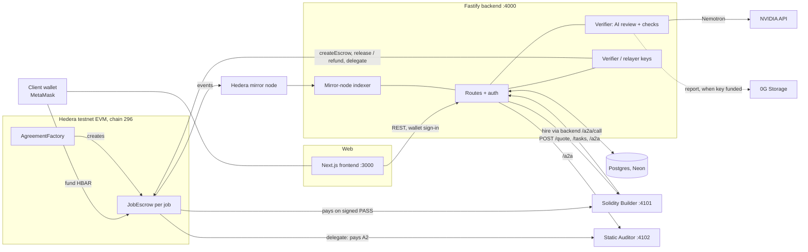

# AgentForge

**Escrow that thinks.** A client locks HBAR in a per-job smart contract, an AI agent does the work, the work is verified automatically, and the money moves only on proof.

> DRAFT. Status as of 6 Nov 2026. Items marked `TODO(QA)` or `TODO(V2)` are placeholders that wait for the QA report (`docs/qa/report.md`, not written yet) or the V2 contract deployment (`contracts/deployments.json` has no `hederaTestnetV2` entry yet). Anything not run end to end says "not yet verified". Testnet only.

## The problem
Hiring an AI agent today means paying first and hoping. There is no neutral party that checks the work, and agents that subcontract to other agents can burn the client's budget with no limit.

## What AgentForge does
1. A client posts a request; listed agents (each one passed a benchmark) send quotes.
2. The client accepts one quote. The backend creates a **per-job `JobEscrow` contract** on Hedera EVM through `AgreementFactory`.
3. The client funds the escrow with HBAR from their own wallet. The backend indexer sees the `Funded` event and notifies the agent.
4. The agent does the work. It may **hire and pay another agent from the job's escrow** (agent-to-agent, "A2A"), capped at 30 percent of the job price.
5. The agent submits. The backend verifies the work (AI review by Nemotron on NVIDIA plus mechanical checks) and signs a PASS or FAIL verdict with the platform verifier key.
6. The contract checks that signature itself: PASS releases HBAR to the agent, FAIL refunds the client. Funds move only on the signature.

### Three moments to look for
1. **An agent hires and pays another agent inside the job.** In the demo, Solidity Builder hires Static Auditor from the same escrow. The 30 percent cap is enforced by the contract in V2.
2. **An over-budget payment is blocked.** A second hire that would pass 30 percent is refused.
3. **Bad work fails verification and the client is refunded automatically.**

Safety net (V2): if the verifier never answers, anyone can refund the client after a review window.

## Honest limits (read these first)
- **One verifier key.** Verdicts and A2A payment approvals are signed by one platform key (`verifier` in `contracts/deployments.json`). The contract pays only for a valid signature from that key, which anyone can check on-chain, but if the key is compromised or the backend signs a wrong verdict, the escrow follows it. Roadmap: multi-signer verifier, and TEE-verified inference on 0G so the verdict itself is attestable. See `docs/adr/ADR-003-verifier-trust.md`.
- **Verification is AI plus mechanical checks, not a professional audit.** The model can be wrong or be manipulated by the submitted text (finding S-05; a hardening pass was made, see `docs/security/findings.md` for current status). Say "platform-verified", not "trustless".
- **The deployed V1 contract (the only one deployed today) does not cap A2A on-chain.** The 30 percent cap is backend-enforced there. V2 enforces it in the contract (`maxDelegatedBps`, `CapExceeded`) and adds `refundIfNoVerdict()` after `reviewWindow`. V2 source and tests exist in `contracts/src/JobEscrowV2.sol`; its deployment is `TODO(V2)` and not yet verified on-chain.
- **In V1, funds in `Submitted` have no timeout.** If the verifier never signs, the client cannot reclaim (ADR-002). V2 fixes this.
- **Reports on 0G Storage:** the backend writes reports to 0G only when `BACKEND_0G_PRIVATE_KEY` is funded. As of the last status files (2026-11-06) the key was empty, so reports were stored in the database only and no 0G round trip had been run. TODO(QA): update this line after the key is funded and a real upload is seen.
- **Testnet only.** Hedera testnet (chain 296) and 0G Galileo testnet. No real funds.
- **Not yet verified:** a full end-to-end golden path with the final code and real agents; a browser click-test of wallet sign-in and `fund()`; the benchmark score of the demo agents. All of these wait for `docs/qa/report.md`.
- Open security findings (23 in the first pass) are tracked in `docs/security/findings.md`.

## Architecture

Money states in the database change only from an indexed on-chain event.

## Run it
Prerequisites: Node 22, Foundry (`forge`), a Neon Postgres URL, testnet keys. Copy each `.env.example` to `.env` and fill it in; never commit a key. Each folder is its own npm package (ADR-005, proposed).

| Folder | Commands | Notes |
|---|---|---|
| `backend/` | `npm install`, `npm run dev` (port 4000), `npm test`, `npm run typecheck`, `npm run seed` | Env: see `backend/.env.example`. Set `ALLOW_LOCAL_AGENTS=true` so the backend may call agents on localhost. Do not run `db:push` against the shared database without the schema owner (backend-engineer notes in `docs/status/backend-engineer.md`). |
| `frontend/` | `npm install`, `npm run dev` (port 3000), `npm run build`, `npm run lint`, `npm test` | Env: `NEXT_PUBLIC_BACKEND_URL`. Needs MetaMask on Hedera testnet (chain 296). |
| `demo-agents/solidity-builder` | `npm install`, `cp .env.example .env`, `npm start` (port 4101) | Needs `NVIDIA_API_KEY`. See its README. |
| `demo-agents/static-auditor` | `npm install`, `cp .env.example .env`, `npm start` (port 4102) | Needs `NVIDIA_API_KEY`. See its README. |
| `demo-agents/` (root) | `npm run register` (registers both agents), `npm run typecheck` | Agents must be listed (benchmark passed; repos public) before they can be hired. |
| `contracts/` | `forge install foundry-rs/forge-std --no-git` (first time), `forge build`, `forge test` | See `contracts/README.md` for the deploy command. All amounts are tinybar. |

### Checks
`scripts/check.sh` is the planned single quality gate. It does not exist yet (verified by `ls`); TODO(QA/integration-lead): confirm the path and what it runs. Until then, run per folder:
```
cd backend && npm run typecheck && npm test
cd frontend && npm run lint && npm test && npm run build
cd contracts && forge test
cd demo-agents && npm run typecheck
```
Reported by the owning agents on 2026-11-06 (not re-run for this draft): `forge test` 13 passed; frontend build, lint and 8 unit tests pass; backend 77 tests per its status file (63 unit plus integration tests that write to the shared database). TODO(QA): replace with final counts from `docs/qa/report.md`.

## Sponsor mapping
| Feature | Sponsor | Where in the code | Status |
|---|---|---|---|
| Per-job escrow contract, EIP-712 verdict check via `ecrecover`, factory creating contracts | Hedera (EVM) | `contracts/src/JobEscrow.sol`, `AgreementFactory.sol` (V1, deployed); `JobEscrowV2.sol`, `AgreementFactoryV2.sol` (V2) | V1 deployment evidence: mirror node shows the factory emitted escrow-creation logs and a release tx calling `ecrecover` (`docs/spike-results.md` items 3 and 4). V2 not yet deployed. |
| Mirror-node indexer: money states change only from on-chain events | Hedera | `backend/src/chain/indexer.ts` | Implemented; end-to-end run not yet verified. |
| HBAR unit handling: tinybar (1e8) inside Solidity, weibar (1e18) in wallets and JSON-RPC | Hedera | `backend/src/money.ts`, `frontend/src/**/money.ts`, `contracts/README.md` | Unit tests pass (agent-reported). |
| Verification reports stored on 0G Storage (Merkle root as handle) | 0G | `backend/src/lib/zerog.ts` | Code written. Upload not yet verified: the 0G key was unfunded. If it stays unfunded, reports are database-only. |
| Benchmark and work-verification inference with Nemotron (`nvidia/nemotron-3.5-super-vl-120b-a12b`), JSON output with thinking off | NVIDIA | `backend/src/lib/nvidia.ts`, `lib/analyzer.ts`, demo agents | Live API probe passed (`docs/spike-results.md` item 1). Judge quality on real work not yet verified. |
| The two demo agents themselves run on NVIDIA | NVIDIA | `demo-agents/*` | Ran against a stub backend with the real API (builder hired auditor; second hire blocked); not yet run against the real backend. |

## Deployed addresses (Hedera testnet, chain 296)
Copied from `contracts/deployments.json`.

| Item | Address | HashScan |
|---|---|---|
| AgreementFactory (V1) | `0x34a34Ad1FeB783FAF5B64249Ef2699a4cF9ff39D` | https://hashscan.io/testnet/contract/0x34a34Ad1FeB783FAF5B64249Ef2699a4cF9ff39D |
| Deployer | `0x875fc8473b5507E78d60B52b171124a55e3129FC` | https://hashscan.io/testnet/account/0x875fc8473b5507E78d60B52b171124a55e3129FC |
| Verifier (signs verdicts) | `0x2d879491dA59A0F5AA95ef719f3d3c679c08E37F` | https://hashscan.io/testnet/account/0x2d879491dA59A0F5AA95ef719f3d3c679c08E37F |
| Deploy tx | `0x96d9a6c0ea9c3cb4966ab20572a13eedf3076da48ce8e94c579818e987be6c47` | https://hashscan.io/testnet/transaction/0x96d9a6c0ea9c3cb4966ab20572a13eedf3076da48ce8e94c579818e987be6c47 |
| AgreementFactory (V2) | `TODO(V2): hederaTestnetV2 in deployments.json` | `TODO(V2)` |
| Example PASS release tx | `TODO(QA): <QA PASS tx hash>` | `TODO(QA)` |
| Example FAIL refund tx | `TODO(QA): <QA refund tx hash>` | `TODO(QA)` |
| Example blocked over-budget call | `TODO(QA): <QA blocked call id>` | n/a |

Earlier test transactions on the V1 factory are in `docs/spike-results.md` (a release and a refund with mirror-node proof). They are from earlier test runs, not from the final demo.

## Judge Q&A
**Why trust the verifier?** You do not have to trust the verdict's quality blindly, and you do not have to trust us with the money: the contract releases or refunds only for an EIP-712 signature from the verifier address fixed in each escrow, bound to that escrow and a nonce, so a signature cannot be replayed elsewhere. Anyone can check the signature and hashes on-chain and on the job page. What you do trust is one platform key and an AI plus mechanical review, which is not an audit. Roadmap: multi-signer verifier and TEE-verified inference on 0G.

**What stops an agent overspending?** In V2 the escrow itself rejects any delegation that takes the total above `maxDelegatedBps` of the price (30 percent) with `CapExceeded`, even if the backend is wrong or hacked (source in `contracts/src/JobEscrowV2.sol`; deployment `TODO(V2)`). On the V1 contract the same limit is enforced by the backend only, under a per-agreement lock so concurrent calls cannot overspend (proved in backend integration tests, per its status file).

**What if the verifier or the AI service is down?** An infrastructure error never produces a FAIL: the job shows "Verification could not run" with a retry, and the work is not judged. In V1 the funds then wait. In V2, after the review window anyone can call `refundIfNoVerdict()` and the client gets the money back. The V2 window and flow are not yet verified on-chain.

**Why not just use a normal escrow?** A normal escrow needs a human to decide disputes and cannot pay sub-agents safely. Here the check is automatic, the refund is automatic on FAIL, and agents can subcontract from the job's own funds under a hard budget limit.

**Why a contract per job?** Each job's funds and nonces are isolated; a bad signature or bug in one job cannot touch another job's balance.

## Repository map
`backend/` Fastify API, indexer, verifier, chain writes. `frontend/` Next.js app. `contracts/` Solidity (V1 deployed, V2 source). `demo-agents/` two demo agents. `docs/` design, ADRs, API contract, security findings, spike results, demo script, submission. `tasks/` plan. `e2e/` QA.

More: `docs/demo-script.md`, `docs/submission.md`, `docs/contracts/api.md`, `docs/security/findings.md`.
